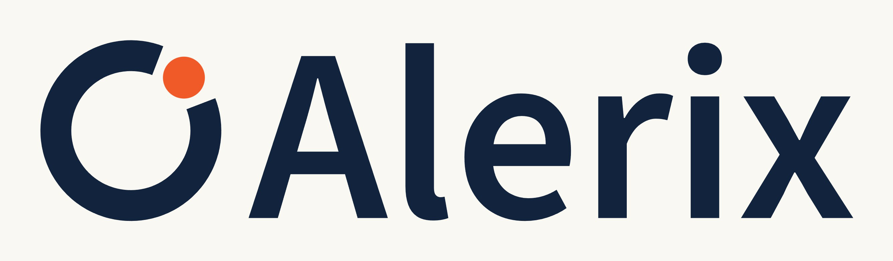

# ALERIX – Tienda Virtual de Productos de Seguridad y Protección Personal

Proyecto formativo del programa **Tecnólogo en Análisis y Desarrollo de Software (ADSO)** del Servicio Nacional de Aprendizaje (SENA), ficha 3293963 (Proyecto 1).

ALERIX es una tienda virtual especializada en la venta de productos de seguridad para el hogar y para vehículos, artículos de protección personal y elementos para emergencias, dirigida a los ciudadanos de Cali. La solución está formada por una página web y una aplicación móvil para Android, desde las que los clientes consultan el catálogo y compran, y una aplicación de escritorio para Windows, desde la que se administra la tienda. Los tres componentes se conectan a un mismo servidor y a una base de datos MySQL.

## Equipo y roles Scrum

| Integrante | Rol Scrum | Frente documental |
|---|---|---|
| Mery Graciela Alvarado Juelpaz | Scrum Master | Análisis |
| Valentina Obando Zuluaga | Product Owner | Diseño: arquitectura y diagramas UML |
| Yaira Nikol Valverde Torres | Development Team | Diseño: mapa de navegación y mockups |
| Melissa Montoya Urbano | Development Team | Base de datos y edición del informe |

Instructora: Margoth Lorena Martinez Diaz.

## Documentos principales

- [Informe Documental del Proyecto Formativo (PDF)](docs/Informe_Documental_ALERIX_Sprint1.pdf)
- [Documento del proyecto ALERIX (PDF)](docs/Documento_Proyecto_ALERIX.pdf): requerimientos, casos de uso, diagramas UML, modelo entidad-relación, diccionario de datos y plan de calidad.
- [Actas de reunión de los Sprints 0 y 1 (PDF)](docs/Actas_Reunion_ALERIX_Sprint0_y_1.pdf)
- [Análisis: SRS, historias de usuario, Product Backlog, casos de uso y trazabilidad (Excel)](analisis/Analisis_ALERIX.xlsx)
- [Arquitectura de la solución (PDF)](diseno/arquitectura/Arquitectura_Solucion_ALERIX.pdf): capas, tecnologías, componentes y despliegue.
- [Diagramas de casos de uso](diseno/casos-de-uso)
- [Identidad visual: imagotipo, colores y manual de marca](diseno/marca)
- [Propuesta de investigación formativa y encuesta (Excel)](investigacion/Propuesta_Investigacion_ALERIX.xlsx)
- [Encuesta sobre la compra de productos de seguridad en Cali (Google Forms)](https://docs.google.com/forms/d/e/1FAIpQLSe4SDujHKSu8S9HsvKWO1icX21ENfCT1RbA3YrIWBhcolOyEA/viewform)
- [Respuestas de la encuesta: 50 respuestas anónimas (Excel)](investigacion/Respuestas_Encuesta_ALERIX.xlsx)

## Organización del repositorio

| Carpeta | Contenido | Sprint |
|---|---|---|
| `/` (raíz) | README con la descripción del proyecto, el equipo y los roles Scrum. | 0 |
| [`/docs`](docs) | Informe documental en Word y PDF, y documento completo del proyecto. | 1 a 3 |
| [`/analisis`](analisis) | SRS, historias de usuario, Product Backlog y casos de uso. | 1 |
| [`/investigacion`](investigacion) | Propuesta de investigación formativa y encuesta. | 1 |
| [`/diseno`](diseno) | Diagramas UML, arquitectura, mapa de navegación, mockups y manual de marca. | 1 y 2 |
| `/base-de-datos` | MER, modelo relacional, normalización, diccionario y script DDL. | 3 |

## Sprints de la actividad

| Sprint | Fechas | Objetivo |
|---|---|---|
| Sprint 0 | 14 de noviembre de 2026 | Organizar el equipo y hacer el inventario de evidencias |
| Sprint 1 | 16 al 21 de noviembre de 2026 | Consolidar la fase de Análisis |
| Sprint 2 | 23 al 28 de noviembre de 2026 | Consolidar la fase de Diseño |
| Sprint 3 | 30 de noviembre al 5 de diciembre de 2026 | Consolidar la base de datos e integrar el informe |

El seguimiento de los sprints se lleva en el [tablero Scrum del proyecto](https://github.com/users/Valentina838-prog/projects/1), que también aparece en la pestaña **Projects** de este repositorio.
